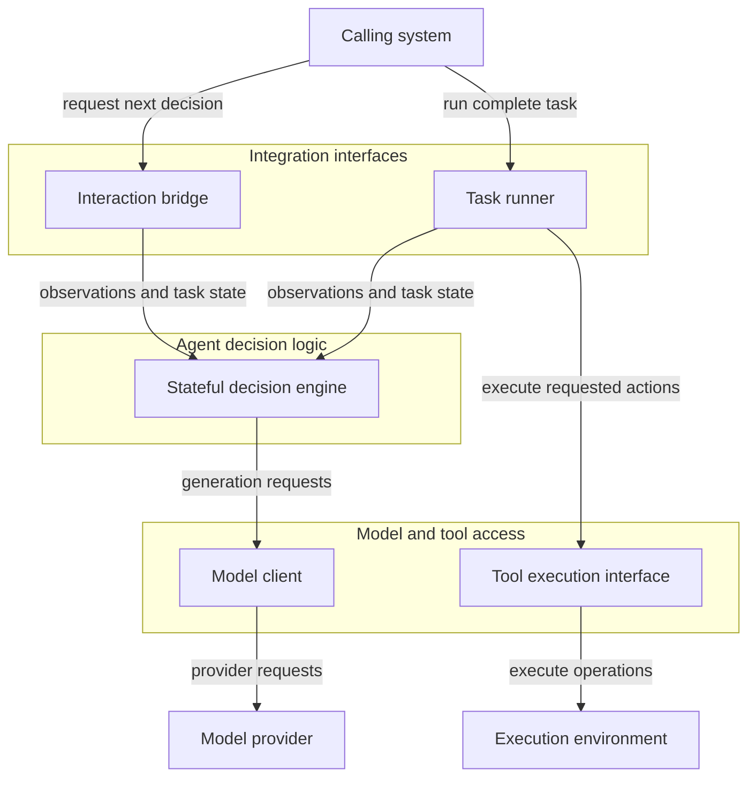

## Reliable agent constitution spec

### 1. Executive summary

#### 1.1. Project description

The project will provide a reusable agent that achieves a high task success rate, consistent results across repeated runs, robustness to meaning-preserving prompt changes, and recovery from transient tool or environment failures. For each completed task, the agent will return an answer, confidence, an explicit indication of whether its answer is likely incorrect, and a short reason. A benchmark-independent decision engine and integration interfaces will support different tool sets and interaction protocols. Later extensions can cover ordinary model tasks, additional agent benchmarks, skills, and MCP.

#### 1.2. Project motivation

A high task success rate alone does not make an agent reliable: its results can change across repeated runs, small prompt changes, or transient failures. The project aims to keep the task success rate high and nearly unchanged despite this noise, and to help users identify results that should not be trusted.

#### 1.3. Implementation repos

https://github.com/anton-pershin/reliable-agent — management and implementation repository.

#### 1.4. Architecture type

Layered architecture. Separate integration interfaces, agent decision logic, and access to models and tools. The decision logic must not depend on a specific benchmark, execution environment, or validation service.

#### 1.5. Execution mode

Manual.

### 2. Requirement analysis

#### 2.1. Functional requirements

- **FR1. Task success rate.** The agent must successfully complete at least 95% of tasks under the baseline evaluation conditions.
- **FR2. Error awareness.** At least 80% of tasks flagged by the agent as likely incorrect must be unsuccessful, and the agent must flag at least 50% of unsuccessful tasks.

#### 2.2. Non-functional requirements

- **NFR1. Consistency.** The difference between the highest and lowest task success rates across repeated evaluation runs under unchanged conditions must not exceed 5 percentage points.
- **NFR2. Prompt robustness.** For each meaning-preserving prompt variant, the task success rate must be no more than 5 percentage points below the baseline success rate.
- **NFR3. Resilience.** For each transient tool or environment failure scenario, the task success rate must be no more than 5 percentage points below the baseline success rate.
- **NFR4. Action budget.** The agent must use no more than 50 environment action attempts per task, including failed attempts and retries.
- **NFR5. Time performance.** At least 95% of task episodes must terminate within 300 seconds, measured from receipt of the task to the final response, including self-assessment. Episodes that reach the time limit without a final response count as unsuccessful.

#### 2.3. Preferences

- **P1. Task execution.** The agent should accept a task, instructions, and available tool descriptions, and use observations and tool results to work toward the task objective.
- **P2. Stateful interaction.** The agent should retain task state across interactions and expose an interface for producing the next action or response. It should also provide a runner for complete task execution when the calling system does not control the interaction loop.
- **P3. Integration.** The agent should support external tool execution and interaction protocols through adapters, without changes to its decision logic. Task setup, observations, action requests, and results should have explicit contracts.
- **P4. Completion and self-assessment.** The agent should explicitly declare task completion and return an answer, confidence, a boolean `likely_incorrect` indication, and a short reason. It should make this assessment without access to private evaluation results.
- **P5. Failure handling.** The agent should use observed tool or environment failures to decide whether to retry, revise its approach, or stop without declaring completion.
- **P6. Configuration.** The agent should expose configuration for model providers, generation settings, prompts, context management, tool bindings, retries, timeouts, execution budgets, and concurrency. Calling systems should be able to override these settings, and the effective configuration should be available without exposing credentials.
- **P7. Framework and data models.** Build the agent around Pydantic AI. Prefer Pydantic models for configuration, interaction contracts, and results.
- **P8. General-purpose reasoning.** The agent should solve tasks through model reasoning and ordinary observations and tool results, without reference answers, private evaluator data, or benchmark-specific solvers.
- **P9. Dependency boundaries.** Keep benchmark-specific integration code separate from the reusable decision engine. The solution should not depend on the identity or implementation of a validation service.
- **P10. Observability.** Write detailed, structured logs for each task episode and each decision, action, tool invocation, and model request. Logs should allow a reader to reconstruct the observable execution sequence and diagnose failures. Include:
  - Task and episode identifiers, linked operation and attempt identifiers, event order, start and end times, durations, and concurrent-operation relationships.
  - Task inputs, effective configuration, implementation and dependency versions, requested model and provider identifiers, available provider-reported identifiers, prompt versions, and configured random seeds.
  - Model request messages, tool descriptions, generation settings, public responses, reported usage, finish reasons, and request errors. Do not require or retain private model reasoning.
  - Action and tool arguments, returned observations, errors, execution status, and any reported or uncertain side effects. Distinguish a failed operation from an operation whose outcome is unknown.
  - Observable task-state updates, context truncation or summarization, loaded skills and resources, and tool availability changes. Record explicit plans or checks when the implementation uses them, without treating them as proof of correctness.
  - Retries, recovery steps, cancellations, timeouts, output parsing or schema failures, repairs, budget use, and termination reasons. Preserve failed and interrupted attempts, not only successful ones.
  - Completion declarations, final answers, confidence, likely incorrect flags, and their reasons. Distinguish the agent's completion claim from any externally established task outcome.
  - Links to retained artifacts and explicit indications of unavailable, omitted, truncated, redacted, or lost log data.

  Logging detail, destinations, and retention should be configurable. Redact credentials and protect sensitive task content before persistence or export. Logs are diagnostic evidence supplied by the solution, not independently verified validation metrics; they should not require a model gateway or changes to the validation boundary.

### 3. Acceptance criteria

An external validation service evaluates each implementation against FR1–FR2 and NFR1–NFR5. The implementation is accepted only when all these requirements are satisfied. Preferences in Section 2.3 are not acceptance criteria.

Use an already running HTTP validation service at a supplied base URL. Send a POST request with `Content-Type: application/json` to:

- `/validate` for full validation against the complete evaluation configuration.
- `/validate_partial` for partial validation against a reduced evaluation configuration. Use partial validation for faster feedback during debugging and tuning, before running full validation. Partial results are diagnostic only and cannot certify acceptance.

Both endpoints accept the same JSON payload:

```json
{
  "repo": "<clonable link to solution implementation repo>",
  "commit": "<commit hash>",
  "solution_overrides": "<args separated by whitespaces>"
}
```

`repo` and `commit` identify the implementation to validate. `solution_overrides` supplies execution configuration overrides; it is optional and defaults to an empty string. The service uses its configured validation profile, which defines the acceptance criteria in scope and the full and partial evaluation configurations.

Expect a JSON response with `profile`, `validation_scope` (`full` or `partial`), and one entry for each acceptance criterion in scope. The following example shows one criterion and one metric; other criteria and metrics use the same structure:

```json
{
  "profile": "default",
  "validation_scope": "full",
  "AC1": {
    "status": "accepted",
    "metrics_status": {
      "VM1": {
        "computation_status": "computed",
        "acceptance_status": "accepted",
        "computed_value": 0.96,
        "expected_value_or_threshold": ">= 0.95",
        "error_message": null
      }
    }
  }
}
```

Each criterion has one of three statuses:

- `accepted`: all its metrics were computed and satisfy their acceptance conditions.
- `valid`: all its metrics were computed, but at least one acceptance condition is not satisfied.
- `invalid`: at least one metric could not be computed.

A metric that could not be computed has `computation_status` set to `failed_to_compute`, `computed_value` set to `null`, and an explanation in `error_message`. A computed metric has `acceptance_status` set to `accepted` or `rejected` and includes the applicable threshold or expected value.

Only a full-validation response with every criterion in scope accepted certifies acceptance.

### 4. Insight

Up to further research.

### 5. Overall solution design

#### 5.1. High-level design

Use three layers: integration interfaces, agent decision logic, and model and tool access. A calling system can request one decision at a time or use the task runner for a complete episode. Benchmark-specific bridges translate interactions without defining a separate decision policy.



Arrows show calls; results return to the caller. When an external system controls the interaction loop, it executes the actions returned through the bridge and supplies the resulting observations. When the task runner controls the loop, it executes actions through the tool execution interface. The internal reliability mechanisms of the decision engine remain subject to further research.

#### 5.2. Core components

- **Integration interfaces**
  - **Interaction bridge:** translates the calling system's task descriptions, observations, and action or response formats to and from the decision engine's contracts. It can implement an external agent base class without adding a separate decision policy.
  - **Task runner:** controls complete task execution when the calling system does not own the interaction loop. It passes observations to the decision engine, executes requested actions through the tool execution interface, and returns the final response or termination outcome.
- **Agent decision logic**
  - **Stateful decision engine:** maintains task state and produces the next action, response, or completion declaration with self-assessment. It uses the model client for generation. Its internal reliability mechanisms remain subject to further research.
- **Model and tool access**
  - **Model client:** provides configurable access to model providers through Pydantic AI, separate from decision logic and interaction protocols.
  - **Tool execution interface:** connects requested actions to an execution environment and returns observations or failures to the task runner. When the calling system owns execution, it supplies these results through the interaction bridge instead.

The calling system, model provider, and execution environment are external to these layers.

### 6. Roadmap

Not specified.
