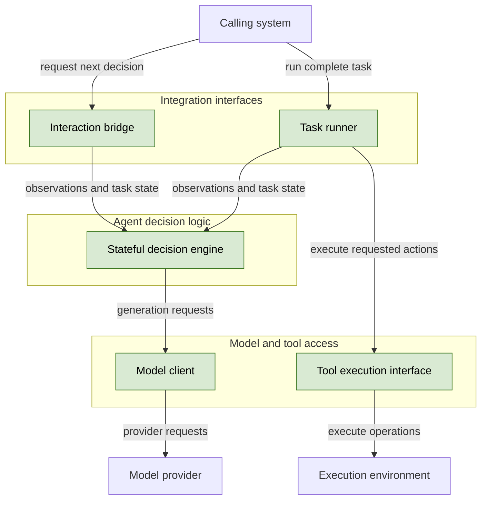
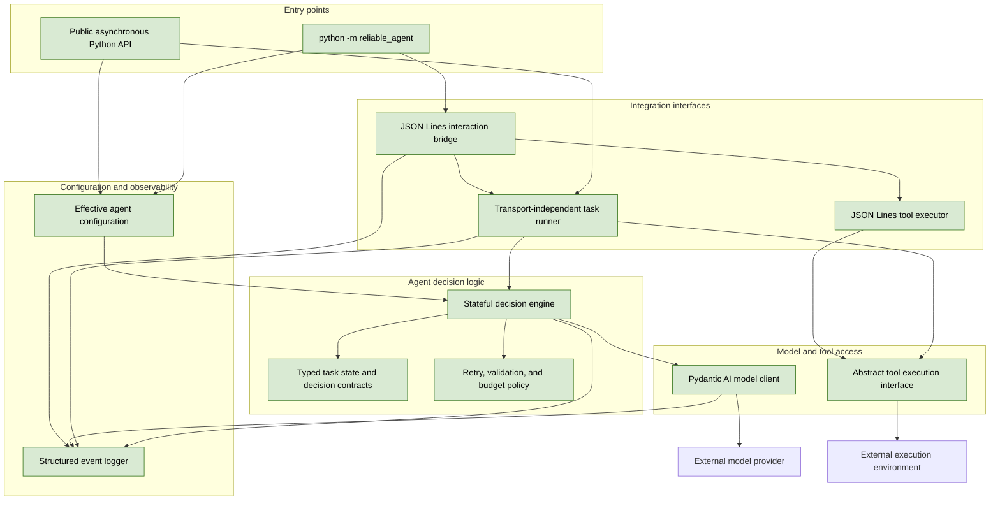

## Baseline reliable agent

### 1. Executive summary

#### 1.1 Spec description

The implementation will provide the first working version of the reusable `reliable-agent`. It will expose a stateful decision engine and task runner built around Pydantic AI, with explicit typed contracts for tasks, observations, action requests, and final responses. It will support `python -m reliable_agent` through the versioned JSON Lines interface, configurable model and execution settings, transient-failure retries, self-assessed final responses, and structured logs. It will include automated tests with model doubles and will not contain benchmark-specific solvers or depend on the validation service.

#### 1.2 Spec motivation

The project needs a working baseline before its reliability mechanisms can be measured and improved. The baseline will establish reusable integration boundaries and produce validation evidence that shows where later specs must improve success, consistency, robustness, resilience, and error awareness.

#### 1.3 Implementation repos

https://github.com/anton-pershin/reliable-agent — management and implementation repository.

### 2. Requirement analysis

#### 2.1 Functional requirements

- **FR1. Typed contracts.** Define Pydantic models for agent configuration, tasks, tool descriptions, action requests, observations, decisions, final responses, and task state. Use explicit types for completion declarations, confidence, `likely_incorrect`, action status, errors, and termination reasons.
- **FR2. Configuration.** Expose model provider and model name, generation settings, prompt version, context limits, tool bindings, transient-failure retries, model request timeouts, action and episode budgets, concurrency, and logging settings. Allow callers to override these settings through `solution_overrides` and the Python API. Make the effective configuration available without credentials.
- **FR3. Model client.** Build model access around Pydantic AI and structured output. Keep provider-specific setup out of the decision engine. Record requested and available provider-reported model identifiers, public responses, usage, finish reasons, and request errors without requiring private model reasoning.
- **FR4. Stateful decision engine.** Retain public task data, instructions, tool descriptions, observations, action attempts, retries, and termination state across decisions. Produce the next action request or final response using only public task information and configured prompts. Do not use reference plans, private evaluator data, goal-achieved signals, or benchmark-specific solvers.
- **FR5. Task runner.** Provide a transport-independent Python runner for complete episodes. It must request decisions, execute actions through a supplied tool execution interface, return observations to the engine, and stop at a final response or a defined termination condition. Keep exactly one action call outstanding and support nonempty batches.
- **FR6. JSON Lines interface.** Support `python -m reliable_agent [solution_overrides]` with protocol version 1 and `task`, `actions`, `observation`, and `final` messages. Use standard input and output for one JSON object per line, use standard error for logs, require string call identifiers, and preserve the documented final-response shape.
- **FR7. Action handling.** Validate requested tool names and arguments against the supplied public schemas before sending an action when possible. Assign unique call identifiers, count all action attempts including catalog requests, rejected actions, batch members, and retries, and never emit an empty batch.
- **FR8. Failure recovery.** Use observed errors to decide whether to retry, revise the approach, or stop. Retry an unchanged action after a transient failure only up to the configured retry limit, then supply the failure to the model for a new decision. Do not treat failed or uncertain operations as successful.
- **FR9. Completion and self-assessment.** Return an answer, numeric confidence, boolean `likely_incorrect`, and a short reason with every complete final response. Set `completed` explicitly and use `completed=false` when stopping without a completion claim. Base the assessment on observable execution evidence, not private correctness results.
- **FR10. Budgets and termination.** Enforce configured action and episode-time budgets, with defaults that keep the agent within 50 action attempts and 300 seconds. Preserve enough time to send a final response when possible. On budget exhaustion, stop without a completion declaration and include the termination reason in logs.
- **FR11. Observability.** Write structured logs for task receipt, effective configuration, implementation and dependency versions, decisions, model requests and responses, action attempts, observations, retries, state updates, budget use, completion, and termination. Include linked episode, operation, and attempt identifiers, event order, timestamps, and durations. Mark omitted or redacted data and never write logs to protocol standard output.
- **FR12. Packaging and documentation.** Provide an installable Python package, the module entry point, the public Python API, configuration examples, and interface documentation. Document installation, provider setup, overrides, logging, failure behavior, and the boundary between public task information and private evaluation.

#### 2.2 Non-functional requirements

- **NFR1. Dependency boundaries.** Keep integration interfaces, decision logic, and model and tool access separate. Do not import benchmark or validation-service code into the reusable engine.
- **NFR2. Repeatable behavior.** Default to deterministic generation settings where the provider supports them, record the effective settings and random seeds, and use the same decision policy across prompt variants and failure conditions.
- **NFR3. Robustness.** Handle model request errors, structured-output errors, malformed decisions, tool failures, timeouts, and cancellation without corrupting protocol output. Preserve failed and interrupted attempts in logs.
- **NFR4. Security and privacy.** Redact credentials and configured sensitive content from logs and effective configuration. Do not expose private evaluation data to the agent or persist private model reasoning.
- **NFR5. State isolation and concurrency.** Keep all mutable task state local to an episode. Support concurrent episodes without shared decision state, global caches, or process-wide configuration changes.
- **NFR6. Testability and maintainability.** Use small typed components with explicit dependencies and model and tool doubles. Cover normal decisions, retries, malformed model output, budget exhaustion, cancellation, and concurrent runners with automated tests that need no real model provider.
- **NFR7. Resource control.** Bound action attempts, model waits, retries, retained context, and protocol messages. Apply configured context limits without hiding truncation from logs.
- **NFR8. Operability and reproducibility.** Make installation and startup errors clear, log dependency and prompt versions, and provide enough public evidence to reproduce the observable decision sequence.

### 3. Acceptance criteria

The implementation will use scripted model decisions, tool doubles, and a controlled clock for deterministic tests. Tests must inspect both public contracts and observable side effects. They must not require private model reasoning or benchmark-specific decision logic.

- **AC1. Contracts and configuration.** Tests must show that valid configuration and interaction objects pass model validation and that invalid action statuses, confidence values, flags, budgets, and messages are rejected or handled as documented. Tests must verify override parsing, default action and time limits, and effective-configuration output without credentials.
- **AC2. Pydantic AI model access.** A test with a Pydantic AI test model must produce a structured decision through the model client. Tests must verify provider-independent engine construction and capture requested and reported model metadata, public responses, usage, finish reasons, and request errors when the provider supplies them.
- **AC3. Stateful decisions.** A sequence of scripted decisions must show that the engine retains task data, instructions, tools, observations, attempts, and retries between calls. Tests must prove that the engine receives no reference plan, private score, goal-achieved signal, or validation-service dependency and that repeated calls do not duplicate prior state.
- **AC4. Task runner.** Tests must cover single actions and nonempty batches, unique call identifiers, supplied tool execution, returned observations, and final termination. At every observation point, exactly one action call must be outstanding. A new runner or a new run must start with clean task state.
- **AC5. JSON Lines contract.** A subprocess test with scripted decisions must exercise `task`, `actions`, `observation`, and `final` messages with exact protocol-version and response fields. Standard output must contain protocol messages only, logs must use standard error, and malformed model or protocol data must produce a controlled outcome rather than corrupting later messages.
- **AC6. Action validation and action budget.** Tests must cover valid and invalid tool names, arguments, and batches. No empty batch may be emitted. Attempt accounting must include catalog requests, malformed or rejected decisions, batch members, and retries. A budget-exhaustion test must show no more than 50 emitted attempts under the default configuration and a final stop without a completion declaration.
- **AC7. Failure recovery.** Tests must show that a transient failure causes an identical retry up to the configured limit and that the resulting observation enters the task state. A nontransient failure must reach the model for a new decision without an automatic identical retry. Failed, rejected, and uncertain operations must not be logged or reported as successful.
- **AC8. Final response and self-assessment.** Tests must verify answer, confidence, boolean `likely_incorrect`, reason, and explicit `completed` values for normal completion and stopped episodes. Invalid structured output must be repaired through Pydantic AI or handled as a controlled termination. Self-assessment inputs must contain observable execution evidence only.
- **AC9. Time and model-wait limits.** With a controlled clock, tests must cover a completed response, a slow model request, request timeout, and episode-budget exhaustion. The default episode budget must remain below 300 seconds and include self-assessment. Tests must show the configured final-response reserve and a termination log when the reserve prevents another model request.
- **AC10. Structured observability.** Tests must parse every emitted log event and verify episode, operation, and attempt links, event order, timestamps, durations, configuration and dependency versions, prompt version, decisions, model events, action observations, retries, truncation, budget use, completion, and termination. Tests must prove that credentials and private reasoning are absent and that omissions and redactions are marked.
- **AC11. Isolation and concurrency.** Tests must run at least two runners concurrently with different tasks and decisions. Task state, call identifiers, overrides, and logs must remain attributable to the correct episode. No test may rely on mutable global decision state or process-wide configuration changes.
- **AC12. Installation and validation compatibility.** A clean environment must install the package, run the full provider-independent test suite, display module help, and complete a documented scripted smoke run. When a model provider is configured, a partial validation run must return the common result shape without protocol-caused episode failures.
- **AC13. End-to-end HTTP validation.** After the implementation is pushed, the agent must start the validation service and send a real full-validation request to `POST /validate` with the `reliable-agent` repository URL, the exact implementation commit, and the required solution overrides. The response must be HTTP `200`, identify profile `default` and scope `full`, contain AC1–AC7 and every required VM metric instance, and use the common result contract. Every metric must have `computation_status=computed` and a non-null `computed_value`; no criterion may have status `invalid`. Record the complete response as implementation evidence. This criterion requires computable metrics, not acceptance of every baseline criterion.

If AC13 exposes a validation-service defect, create a separate KISS spec in `agent-validation`. Collect all requirements for the necessary validation changes in that spec and implement them before rerunning AC13. Do not include unplanned validation-service changes in the baseline-agent implementation branch.

### 4. Overall solution design

#### 4.1 High-level design

All solution components are new. The following diagram preserves the constitution architecture and highlights the components created by this spec.

The next diagram shows the internal component boundaries. The decision engine depends on abstract model and tool contracts, not on the JSON Lines transport or a benchmark. The process adapter supplies a tool executor that sends action requests to the calling system and waits for observations.

The public API uses asynchronous calls. The JSON Lines entry point runs one episode with `asyncio.run` and exits after the final response or a controlled termination. A supplied Python tool executor can run the same engine without the process adapter.

The model returns one of two structured decisions:

- `ActionDecision`: a nonempty list of action requests. Each request has a tool name and JSON arguments.
- `FinalDecision`: `completed`, `answer`, `confidence`, `likely_incorrect`, and `reason`.

The engine and runner add transport identifiers, observations, and attempt metadata; the model does not supply them. The runner counts every emitted environment action. The engine also records rejected model decisions in its internal budget and logs them separately from environment action attempts.

The default configuration requires an explicit model identifier through the Python API, `--model`, or `RELIABLE_AGENT_MODEL`. It uses deterministic generation where supported, prompt version `baseline-v1`, at most 45 emitted action attempts, two transient-failure retries per action, a 270-second episode budget, a model request timeout, bounded context, and a final-response reserve. These values are configurable, but the validation-compatible defaults must not exceed the constitution limits.

After a transient failure, the engine retries the same action without another model request until the configured limit is reached. It then gives the observed failure to the model for a new decision. Provider errors, invalid structured decisions, and budget exhaustion produce a controlled final response with `completed=false`, zero or low confidence, `likely_incorrect=true`, and a public reason.

The structured logger writes JSON events to standard error. It records public task and decision evidence, model metadata, action attempts, observations, retries, truncation, and termination. Credentials, private evaluation data, and private model reasoning are excluded or redacted.
