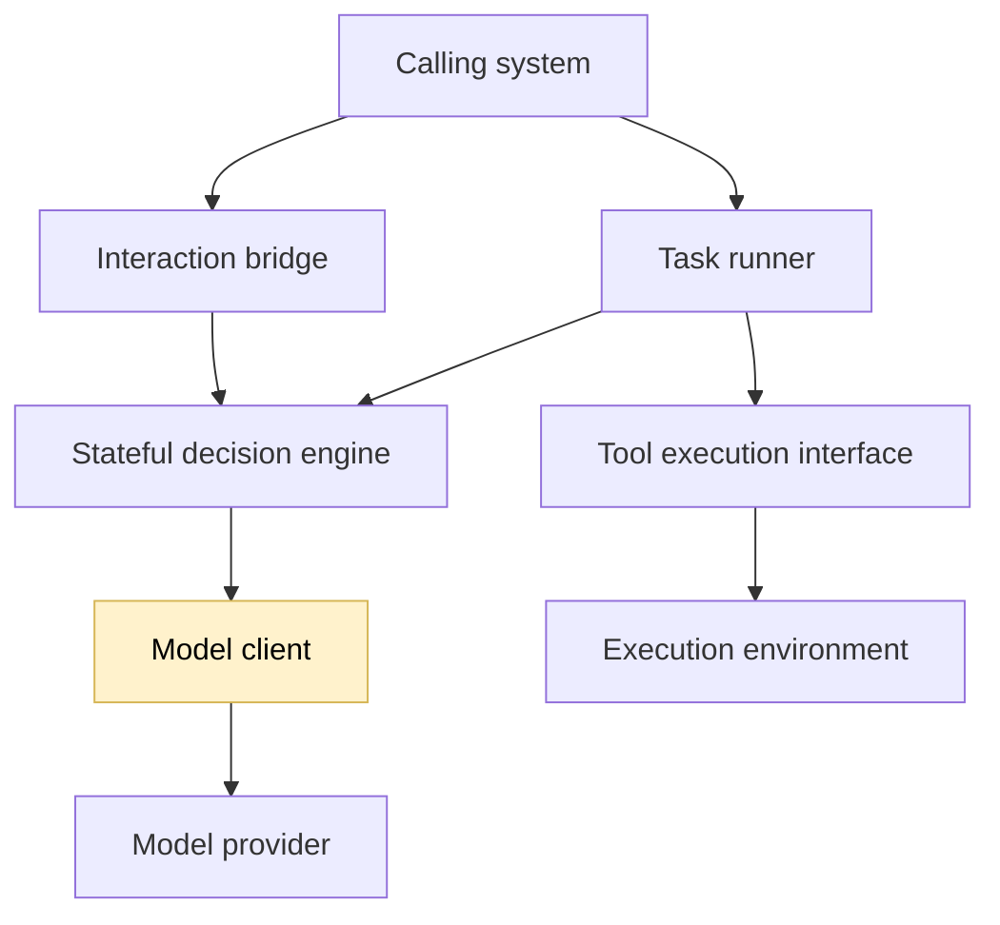
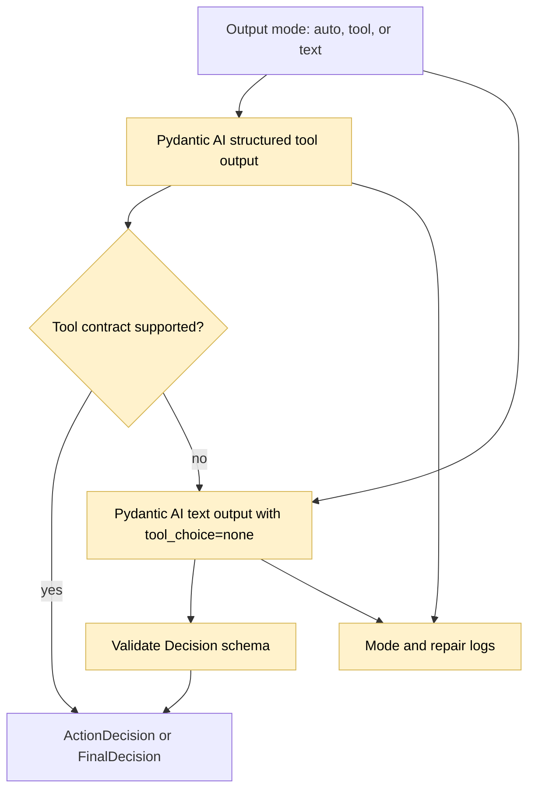

## Text JSON fallback

### 1. Requirement analysis

- **R1. Configurable output mode.** Add an `output_mode` setting with `auto`, `tool`, and `text` values and a matching `--output-mode` override. Keep `auto` as the default.
- **R2. Existing tool path.** In `tool` mode, preserve the current Pydantic AI structured-tool behavior. In `auto` mode, try that behavior first without changing successful providers.
- **R3. Validated text fallback.** In `text` mode, use Pydantic AI text output with `tool_choice=none`, request a JSON object matching the existing decision schema, remove Markdown fences when present, and validate it with the existing `Decision` type. In `auto` mode, use this fallback only when the provider rejects the tool-choice contract or does not support tool-based output.
- **R4. Failure handling and evidence.** Log the selected mode, fallback activation, public text response, parsing or schema failures, and repairs. Invalid JSON, wrong decision variants, and invalid fields must produce controlled errors or fallback decisions without corrupting JSON Lines output. Preserve model metadata and seed settings.
- **R5. Public contract and documentation.** Keep the engine, runner, decision models, and JSON Lines protocol unchanged. Document the new mode and configuration example for `alibaba-qwen2-5-coder-7b-instruct-awq`.

Expected behavior variants:

- **B1. Tool-capable provider.** Existing structured-tool requests succeed without fallback and produce the same decisions.
- **B2. Tool-rejecting provider.** A provider that rejects `tool_choice=required` falls back to text JSON and produces the same validated decision type.
- **B3. Invalid text.** Fenced or plain invalid JSON and schema-invalid decisions are logged and handled in a controlled way.
- **B4. Less performant model.** `alibaba-qwen2-5-coder-7b-instruct-awq` completes partial and full HTTP validation with every required metric computed.

### 2. Tests

- **T1. Tool-mode regression.** Run the existing Pydantic AI structured-tool tests and verify identical action and final decisions, metadata, seed settings, and absence of fallback events. Covers B1 and R2.
- **T2. Automatic fallback.** Simulate a provider that rejects `tool_choice=required` and then returns valid text JSON. Assert fallback activation, `tool_choice=none`, a correctly typed decision, and public fallback logs. Covers B2 and R3–R4.
- **T3. Text validation.** Cover plain and fenced JSON, malformed text, wrong decision variants, and schema-invalid fields. Assert controlled model errors or fallback decisions and valid protocol output. Covers B3 and R4.
- **T4. Configuration.** Parse `--output-mode` and verify `auto`, `tool`, and `text` values, invalid-value rejection, effective configuration, and documentation examples. Covers R1 and R5.
- **T5. Real-model validation.** Independently confirm the smaller model's text JSON behavior, then run partial and full HTTP validation for the exact implementation commit. Require the common result shape and every required metric computed. Run the full provider-independent suite, Ruff, and whitespace checks. Covers B4 and R5.

### 3. Implementation plan

#### 3.1 Implementation repos

https://github.com/anton-pershin/reliable-agent — management and implementation repository.

#### 3.2 High-level design

Only the model client and configuration change. The model client selects the output path and records the result; all other components keep their current boundaries.

The model client tries the existing structured-tool path when configured. On a supported tool-contract rejection, it repeats the request through the text-output path and validates the result with the existing `Decision` type.

No change is needed in engine state, action retries, budgets, tool execution, or JSON Lines transport.
