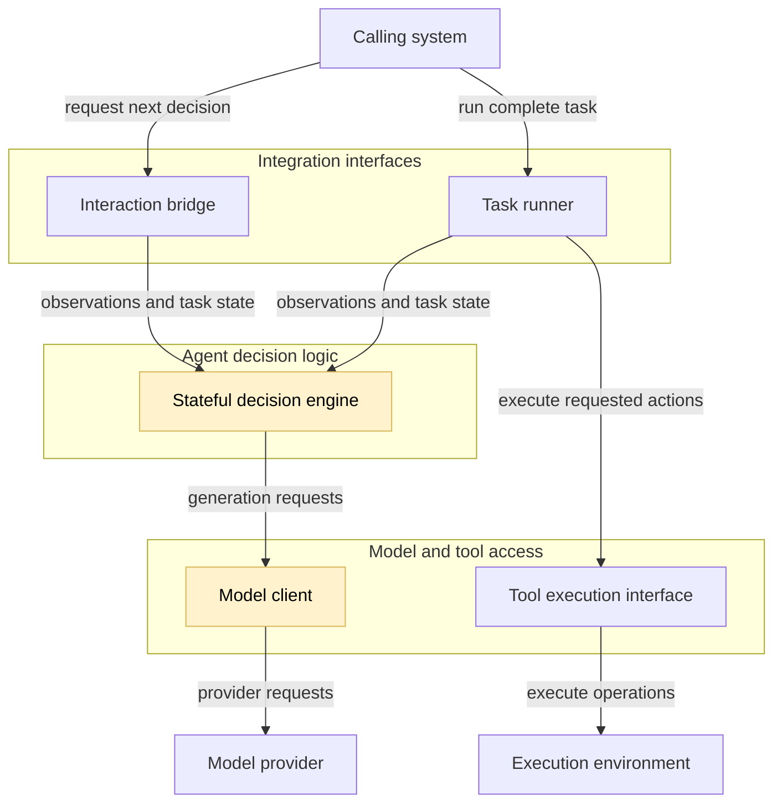
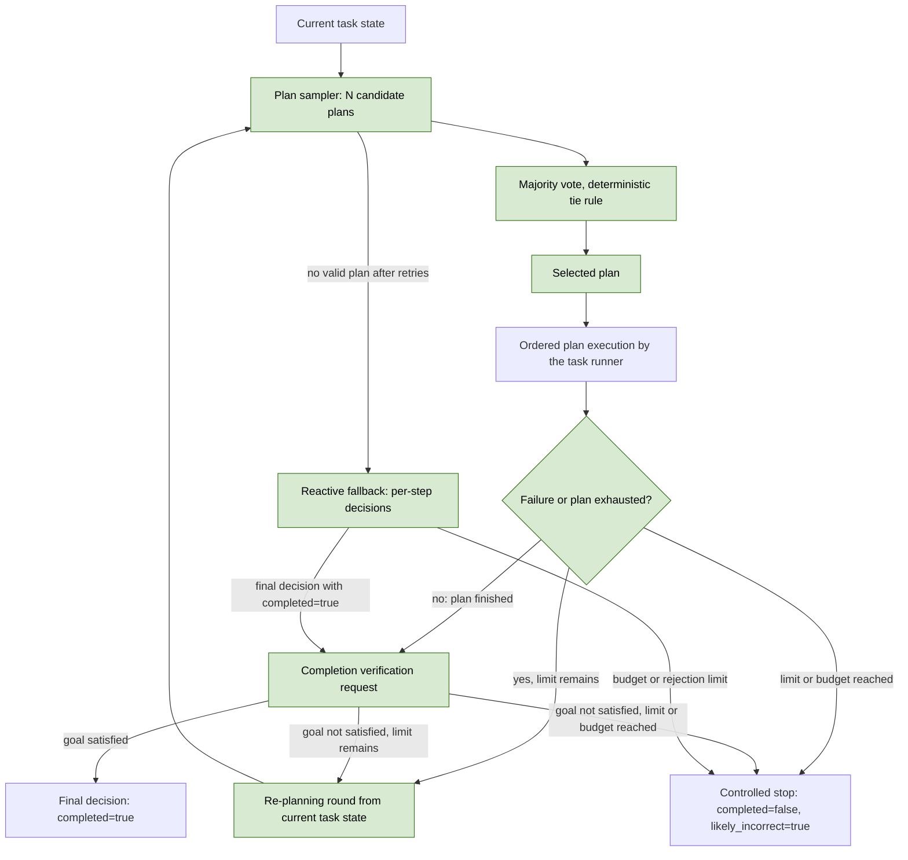
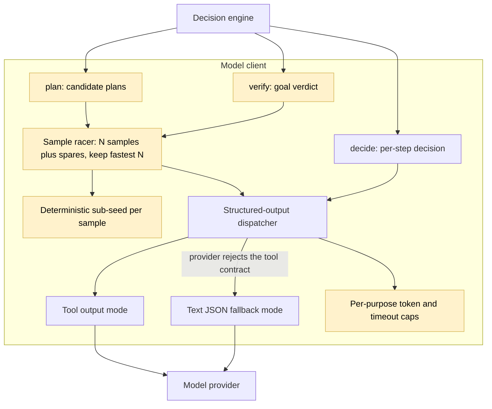

## Consistent planning

### 1. Executive summary

#### 1.1 Spec description

The implementation will make the agent's results stable across repeated evaluation runs under unchanged conditions. The decision engine will request a complete candidate plan from the model, select one plan by a majority vote over several samples, and execute the selected plan in order through the existing task runner. Before any completion declaration, the engine will verify the task goal against the latest public observations in a dedicated model request, and it will re-plan from the current task state after an action failure or a rejected verification. The model identifier, temperature, and sampling settings stay unchanged.

#### 1.2 Spec motivation

Full validation of the spec 02 implementation gave VM4 = 0.15 against the threshold `<= 0.05`: the unperturbed overall success rates varied from 0.80 to 0.95 across repeats 1 through 10. The evidence shows that a small set of tasks causes this variance through false completion declarations, premature stops, model timeouts, and wrong plans, all driven by sampling noise at temperature 0.7. The project must reduce this variance as much as possible, keep VM1 at or above the baseline value 0.855, and keep the same model and the same temperature and sampling settings.

#### 1.3 Implementation repos

https://github.com/anton-pershin/reliable-agent — management and implementation repository.

### 2. Requirement analysis

#### 2.1 Functional requirements

- **FR1. Candidate plans.** At the start of an episode, the engine must request from the model a candidate plan: an ordered list of action requests that is expected to satisfy the task objective from the current task state. The plan request must use only public task information: the task, the instructions, the tool descriptions, and the observations collected so far.
- **FR2. Plan vote.** The engine must sample candidate plans with the configured temperature and sampling settings for every sample and select one plan by a majority vote over normalized action sequences, with a documented deterministic rule for ties. The engine must fire one spare sample per vote and keep the fastest completions, so that a slow sample does not block the round. Each sample must use a deterministic sub-seed derived from the configured random seed and the sample index, so that providers do not return identical completions for identical requests. The default vote size is 3. Concurrent samples must not share mutable state. The engine must exclude candidates that already failed in the same episode from the vote while fresh candidates remain.
- **FR3. Plan execution.** The task runner must execute the selected plan in order through the existing action pipeline. Action validation, attempt counting, batch rules, and transient-failure retries must stay unchanged.
- **FR4. Re-planning.** The engine must request a new plan vote from the current task state when an action fails after its transient-failure retries or when the selected plan is exhausted without a completion declaration. A configurable limit must bound the number of re-planning rounds per episode. At the limit, the engine must stop with `completed=false` and `likely_incorrect=true`.
- **FR5. Completion verification.** In plan mode, the engine must verify the task goal in dedicated model requests as soon as the selected plan is exhausted. The engine must fire a configurable number of concurrent verification samples (default 2) with deterministic sub-seeds and use the fastest successful verdict, so that a slow sample does not block the episode. A completion declaration in plan mode is synthesized by the engine from a satisfied verdict, without another model request. If the verification rejects the completion or is unavailable, the engine must re-plan or stop with `completed=false` and `likely_incorrect=true`; an unverified completion claim must never be accepted in plan mode. In reactive mode, the engine must verify the task goal before it accepts a final decision with `completed=true`, with the same rule for rejected and unavailable verifications. The verification request must use only public task information, and it must present the latest observation without the earlier history.
- **FR6. Premature-stop guard.** The engine must reject a final decision that stops the episode while the episode has made no successful action progress and the action and time budgets remain. The rejection must return feedback to the model and must count against the existing decision-rejection budget.
- **FR7. Reactive fallback.** If the model cannot supply a valid plan after the configured decision retries, the engine must fall back to the existing per-step decision loop for the rest of the episode or until a later re-planning round succeeds. Every episode must make progress or end in a controlled stop.
- **FR8. Configuration.** Expose a planning enable flag, the number of plan samples, the number of verification samples, the re-planning limit, an enable flag for completion verification, and the verification sample timeout in `AgentConfig` and in the command-line overrides. The default values must keep the agent within the constitution action and time budgets.
- **FR9. Unchanged model access.** The implementation must not change the configured model identifier, temperature, or other sampling settings for validation runs. It must log every requested seed, including the derived sub-seeds. Output-token limits are not sampling settings: the implementation may raise the default output-token limit to prevent token-limit failures before any response is generated, and it may apply a lower per-request cap to plan samples, whose outputs are small.
- **FR10. Observability.** Log every candidate plan, the vote result, the selected plan, every re-planning event with its cause, every verification request and result, and every guard rejection. Link these events to the episode and operation identifiers.

#### 2.2 Non-functional requirements

- **NFR1. Consistency improvement.** Under full validation, VM4 must be as low as possible with the target `<= 0.05`, and in all cases strictly below the baseline value 0.15.
- **NFR2. Success-rate floor.** Under full validation, VM1 must stay at or above the baseline value 0.855.
- **NFR3. No criterion regression.** Every criterion that was `accepted` in the baseline full validation (AC4, AC6, AC7) must stay `accepted`. No criterion may become `invalid`.
- **NFR4. Budget compliance.** Every episode must stay within 50 action attempts and 300 seconds, including plan sampling, verification, and re-planning requests. The final-response reserve must stay effective; in plan mode it may be reduced, because verified final responses are synthesized without a model request. The default episode budget must stay below 300 seconds with enough margin for the final write.
- **NFR5. Benchmark independence.** Planning, voting, and verification must use general-purpose reasoning over public task data only. The implementation must not use reference answers, private evaluator data, benchmark-specific solvers, or the validation service.
- **NFR6. Testability.** Model doubles and a controlled clock must cover all new logic. Tests must not require a real model provider.

### 3. Acceptance criteria

The implementation will use scripted model decisions, tool doubles, and a controlled clock for deterministic tests. Validation-service runs must use the same model (`openai:qwen/qwen3.5-9b`), the same temperature (0.7), and the same sampling settings as the baseline.

- **AC1. Plan contracts and vote.** Tests with scripted model outputs must show that valid candidate plans pass validation, malformed plans are repaired or rejected, the vote selects the majority plan, ties follow the documented deterministic rule, and the derived sub-seeds are deterministic and logged. Covers FR1, FR2, and FR9.
- **AC2. Execution and re-planning.** Tests must show in-order execution of the selected plan, re-planning after an action failure after retries, re-planning after plan exhaustion without completion, enforcement of the re-planning limit, and the controlled stop at the limit with `completed=false` and `likely_incorrect=true`. Covers FR3 and FR4.
- **AC3. Completion verification.** Tests must show that the engine sends a completion declaration only after a positive verification, that a negative verification triggers re-planning or a controlled stop, and that the verification request contains public task data only. Covers FR5 and NFR5.
- **AC4. Premature-stop guard and reactive fallback.** Tests must show rejection of a premature stop while budgets remain, feedback to the model, enforcement of the decision-rejection budget, and the reactive fallback after invalid plans. Covers FR6 and FR7.
- **AC5. Budgets and concurrency.** Tests with a controlled clock must show that plan sampling, verification, and re-planning stay within the action and time budgets, that concurrent plan samples do not share mutable state, and that concurrent episodes stay isolated. Covers NFR4 and the concurrency part of FR2.
- **AC6. Observability.** Tests must parse the new log events and verify episode and operation links, event order, timestamps, candidate plans, vote results, re-planning causes, verification results, and the absence of credentials and private reasoning. Covers FR10.
- **AC7. Configuration.** Tests must parse the new overrides, verify the defaults, reject invalid values, and show the effective configuration without credentials. Covers FR8.
- **AC8. Partial validation.** A `POST /validate_partial` request against the implementation commit must return the common result shape with every metric computed. The unperturbed per-repeat success rates must show no VM1 regression on the partial task set. Partial results are diagnostic only.
- **AC9. Full validation.** A `POST /validate` request against the implementation commit must show: VM4 strictly below 0.15 with the target `<= 0.05`; VM1 at or above 0.855; AC4, AC6, and AC7 `accepted`; no criterion `invalid`. Record the complete response and the summary in `.internal/validation-results.md`.

### 4. Overall solution design

#### 4.1 High-level design

The change stays inside the decision engine and the model client. The integration interfaces, the contracts, and the tool execution interface keep their current boundaries. The diagram from the constitution spec highlights the modified components.



The next diagram shows the new decision flow inside the decision engine. The plan sampler collects several candidate plans with the configured sampling settings. The vote selects one plan. The runner executes the selected plan in order. The completion gate verifies the goal before any completion declaration. Failures, plan exhaustion, and rejected verifications start a new round from the current task state until the re-planning limit or a budget forces a controlled stop.



Plan sampling reuses the configured temperature and sampling settings for every candidate. Only the seed differs: sample `i` uses a deterministic sub-seed derived from the configured random seed and `i`. Every vote fires one spare sample and keeps the fastest completions, and verification fires two samples and keeps the fastest verdict, so that a slow request does not block the episode. All samples for one decision run concurrently and write no shared state. The vote compares normalized action sequences, excludes plans that already failed in the same episode while fresh candidates remain, and uses the lowest sample index to break ties. The completion verification request contains the task input and the latest observation without the earlier history, and it returns a satisfied or not-satisfied verdict with the missing goal predicates and a short reason. A completion declaration in plan mode is synthesized by the engine from a satisfied verdict; a rejected or unavailable verification starts a new plan round.

A candidate plan is a JSON object with one ordered list of action requests. Example:

```json
{
  "actions": [
    {"name": "unstack", "arguments": {"block": "b", "other_block": "c"}},
    {"name": "put_down", "arguments": {"block": "b"}},
    {"name": "pick_up", "arguments": {"block": "c"}},
    {"name": "stack", "arguments": {"block": "c", "other_block": "a"}}
  ]
}
```

The majority vote needs an exact equivalence rule because two sampled plans can differ by details that do not matter, such as the key order inside an `arguments` object. The engine normalizes each action to the pair `(name, canonical JSON of arguments)`: the arguments are serialized with sorted keys, so `{"block": "c", "other_block": "a"}` and `{"other_block": "a", "block": "c"}` normalize to the same value. A whole plan normalizes to the ordered sequence of these pairs. Two candidate plans are equivalent exactly when their normalized sequences are identical, element by element: same action names, same argument values, same order. Any other difference, however small, makes two plans different.

The vote counts the candidates in each equivalence class. The class with the most candidates wins. Example: samples return plans A, B, A; A wins 2:1. If every plan is different (A, B, C), there is no majority: the tie rule selects the plan with the lowest sample index, which keeps the result deterministic. Candidates equivalent to a plan that already failed in the same episode are removed before the count; if nothing remains, the removal is canceled for that round.

The first diagram shows the model client as modified. The next diagram shows what changed inside it. The client has three entry points: `decide` (the per-step decision used in reactive mode), `plan` (candidate plans for one vote), and `verify` (the goal verdict). All three share the structured-output dispatcher, which tries the tool-output contract first and falls back to validated JSON text in `auto` mode. `plan` and `verify` go through the sample racer, which fires the configured number of samples plus spares concurrently, keeps the fastest completions, and assigns every sample its derived sub-seed. Per-purpose limits keep the episode fast: plan samples use a lower output-token cap, and verification samples use a shorter timeout.


