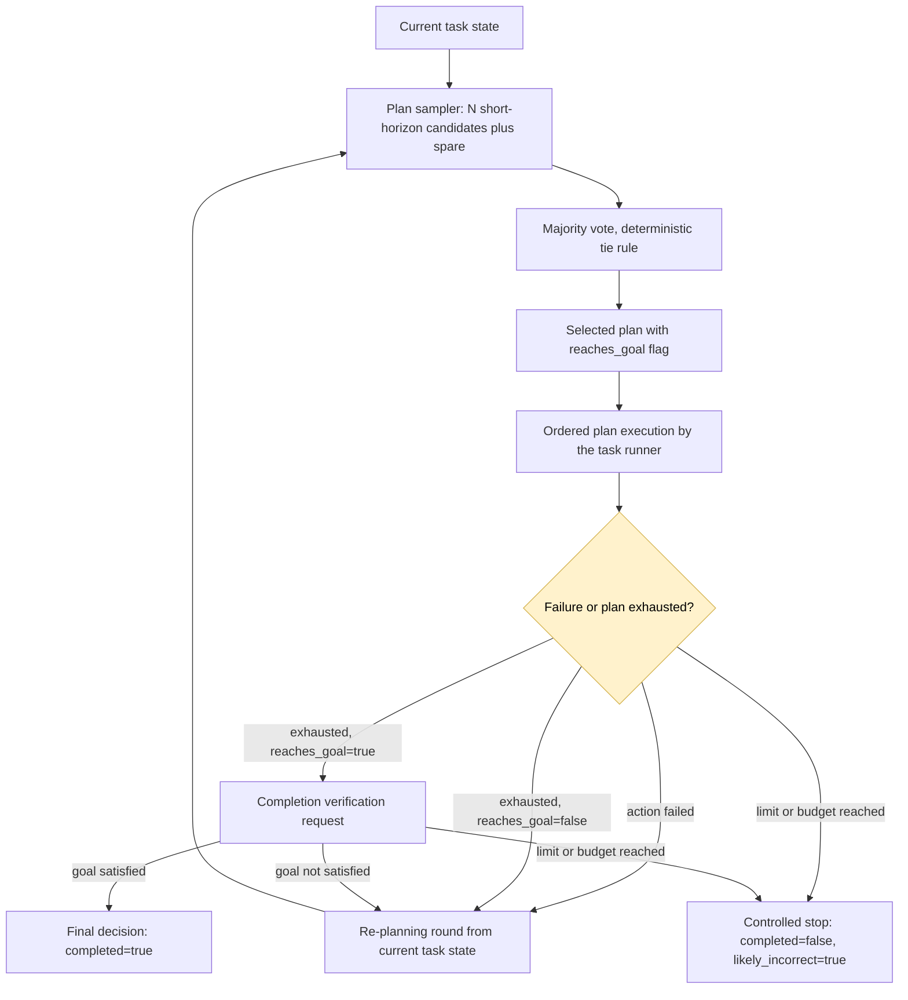

## Repeatable planning through short-horizon consensus

### 1. Executive summary

#### 1.1 Spec description

The implementation will make the agent's per-task outcomes nearly deterministic across repeated evaluation runs without changing the temperature or other sampling settings. The planner will support a configurable short planning horizon: instead of one long plan that tries to reach the objective in a single shot, the model returns the next few actions, flags whether they complete the objective, and the engine re-plans after each short plan. Short plans agree with each other far more often than long plans, so the majority vote becomes a real consensus instead of a coin flip, and every episode follows a stable decision trajectory. The model client will stop wasting plan samples on the 2000-token output cap and will retry samples that fail on timeouts and transient provider errors. Re-planning rounds will receive explicit failure feedback. The model identifier, the temperature, and the episode budgets stay unchanged.

#### 1.2 Spec motivation

Full validation of the spec 03 implementation under the `blocksworld_hard` profile (run `20261109T031132-994501Z-f22e7aa722f7`) gave VM4 = 0.40 against the threshold `<= 0.05`: the unperturbed success rates were 0.60, 0.55, 0.70, 0.60, 0.60, 0.70, 0.30, 0.35, 0.35, and 0.60 for repeats 1 through 10. VM1 was 0.535. The episode evidence and offline replay of the exact plan prompts against the same model show four variance drivers:

1. **Long plans never agree.** At temperature 0.7 the first-round plan distribution is nearly flat: 7-10 distinct plans out of 10 samples per task. In the validation run, 87% of votes had a top count of 1, so the documented tie rule (lowest sample index) decided the plan essentially at random. Offline replay confirms that no vote size fixes this: there is no modal long plan to converge to.
2. **First actions do agree.** The same offline replay shows strong consensus on the first action (modal share 4-9 out of 10 samples). The model knows what to do next; it cannot keep a long tail coherent. Short-horizon plans exploit exactly the part of the distribution that has a mode.
3. **Token-cap sample failures.** Plan samples used a hard-coded 2000-token output cap. The evaluation model reasons before it answers, and 662 samples across the full run died at that cap before producing any response. Successful plan responses used 894 tokens at the median and up to 5136 tokens, so the cap discarded exactly the samples that thought longest about the hardest states.
4. **Provider latency spikes.** Repeats 7 through 9 ran during a provider slow window (UTC 10:24-15:15): 74 sample requests timed out across the run, 26 of them in the failed unperturbed episodes of repeats 7-9, each burning up to 180 seconds of the 285-second episode budget. Failed samples were not retried, so a slow provider directly converted into lost episodes and cross-repeat variance.

The environment used by the validator never corrupts its state on a rejected action: a failed action leaves the state unchanged, so every re-planning round resumes from a valid state and the episode trajectory is a monotone-progress walk bounded by the time budget. Short, reliable rounds both raise the walk's success probability and make it repeatable.

The validation configuration for this spec is `--model openai:qwen/qwen3.5-9b --temperature 0.7 --model-timeout 90 --sample-retries 2 --plan-max-output-tokens 3000 --no-plan-review`: the same model, temperature, and sampling settings as the baseline, with faster stall recovery and a bounded plan-sample tail.

The project must make VM4 meet `<= 0.05` on the `blocksworld_hard` profile while keeping VM1 at or above 0.50 and not regressing any criterion that was `accepted`. The temperature stays at 0.7 for validation runs.

#### 1.3 Implementation repos

https://github.com/anton-pershin/reliable-agent — management and implementation repository.

### 2. Requirement analysis

#### 2.1 Functional requirements

- **FR1. Unchanged sampling configuration.** Validation runs for this spec must use the same model (`openai:qwen/qwen3.5-9b`), the same temperature (0.7), and the same sampling settings as the spec 03 baseline. The configured random seed must stay constant across repeats: `solution_overrides` must not use the `{repeat}` placeholder.
- **FR2. Planning horizon.** `AgentConfig.plan_horizon` with the command-line override `--plan-horizon` must bound the number of actions the planner may return in one candidate plan. The default 0 keeps the current behavior: the planner returns one complete plan. With a horizon H > 0, the plan instructions must require at most H ordered actions and must require the model to set the `reaches_goal` flag: true only when executing the whole returned plan satisfies the task objective.
- **FR3. Plan completion flag.** `PlanCandidate` gains a `reaches_goal` boolean (default true) and allows an empty action list. An empty candidate with `reaches_goal=true` means "the objective is already satisfied; verify now". An empty candidate with `reaches_goal=false` is invalid and must be excluded from the vote. A non-empty candidate behaves as today.
- **FR4. Horizon round flow.** When a plan with `reaches_goal=false` is exhausted, the engine must skip completion verification and start a new plan round immediately; the exhausted plan must not be marked as failed. When a plan with `reaches_goal=true` is exhausted, the existing verification path applies unchanged, including marking the plan failed on rejection. With horizon 0 every plan is treated as `reaches_goal=true`, which reproduces the current flow exactly.
- **FR5. Configurable plan token cap.** The per-request output-token cap for plan samples must move from a hard-coded constant to `AgentConfig.plan_max_output_tokens` with the command-line override `--plan-max-output-tokens`. A value of 0 must mean "no plan-specific cap: use the global output-token limit". The default must be 0, because a sample that dies at the cap wastes its full latency and tokens. Decision and verification requests keep the global output-token limit.
- **FR6. Sample retry after transient failure.** Every plan or verification sample that fails with a timeout, a connection error, or a transient provider error (HTTP 408, 409, 425, 429, 5xx, quota errors) must retry with a fresh request, up to `AgentConfig.sample_retries` retries (command-line override `--sample-retries`, default 1). The retry must use the remaining episode time as its timeout and the same deterministic sub-seed. Token-limit, schema, and validation failures are deterministic and must not retry. Each retry must be logged with the sample operation identifier and the failure type.
- **FR7. Re-plan failure feedback.** When a plan breaks because an action failed after its transient-failure retries, the engine must append one concise public feedback entry to the task state before the next plan round, naming the failed action and its public error message. The feedback must use only public observation data.
- **FR8. Plan review with truncation.** Each valid candidate plan must pass a model-based validity review before the vote: a dedicated model request receives the public task data, the latest observation, and one candidate plan, and returns whether every action's preconditions hold in the order of the plan, with the zero-based index of the first invalid action. Offline measurement against an independent simulator showed the review catches 91% of invalid plans at 97-100% precision and names the exact breaking action in 95% of cases, while plan generation solves 10% of tasks in one shot: checking a plan is much easier for the model than producing one. A candidate whose review reports a first invalid action at index k is truncated to its valid prefix of k actions with `reaches_goal=false`; the prefix still makes progress and its execution re-plans without verification. A candidate invalid at index 0 is dropped. If every candidate is dropped, the engine appends the review reasons to the task-state feedback and starts a new plan round; the re-planning limit still applies. A review request failure must not change the candidate: the unreviewed candidate stays in the vote. Reviews run concurrently, one sample per candidate, with the verification sample timeout. The review must use only public task information. The feature is controlled by `AgentConfig.plan_review_enabled` (default on) with the command-line override `--plan-review / --no-plan-review`.
- **FR9. Goal review.** After the validity review, candidates that still claim completion pass a goal check: a dedicated model request simulates the candidate and reports whether the final state satisfies every goal predicate. Measured on the default profile against an independent simulator: 92% recall on goal-reaching plans, 75% precision among valid plans. When at least one candidate passes, the vote runs only among the passing candidates. The feature is controlled by `AgentConfig.goal_review_enabled` (default on) with `--goal-review / --no-goal-review`.
- **FR10. Conflicting-predicate feedback.** A rejected completion verification must list not only the missing goal predicates but also the predicates currently true that conflict with the goal (same predicate name, different arguments), so the next plan can undo or avoid them. The verifier extracts both lists from public data only.
- **FR11. Spare plan samples.** The number of spare plan samples per vote must move from a hard-coded 1 to `AgentConfig.plan_spares` (command-line override `--plan-spares`, default 1). Spares take the slow tail of the sample latency distribution off the critical path; under provider latency spikes they keep the round alive without retries.
- **FR12. Observability.** Log every sample retry with its cause, the effective plan token cap, plan-exhaustion events with the `reaches_goal` flag, every plan review verdict with the candidate index and the first invalid action index, and the new configuration values. Existing plan, vote, verification, and termination events must keep their shapes.
- **FR13. Unchanged boundaries.** The integration interfaces, the runner, and the environment interface keep their current boundaries. Planning, voting, and verification must use general-purpose reasoning over public task data only; no benchmark-specific logic. The horizon must be expressed in actions, never in benchmark-specific terms.

#### 2.2 Non-functional requirements

- **NFR1. Repeatability.** Under full validation on the `blocksworld_hard` profile, VM4 must be `<= 0.05` (AC3 `accepted`).
- **NFR2. Success-rate floor.** Under the same run, VM1 must stay at or above 0.50 (baseline: 0.535). A rise is welcome but not required.
- **NFR3. No criterion regression.** AC2, AC6, and AC7 must stay `accepted`. AC5 must not lose metric instances it computed in the baseline run (it may stay `invalid`).
- **NFR4. Budget compliance.** Every episode must stay within 50 action attempts and 300 seconds, including retries. Sample retries must never extend an episode beyond its budget, because each retry uses the remaining episode time as its timeout. With a horizon, the default re-planning limit must remain compatible: a horizon-H episode needs about (optimal plan length / H) rounds plus failure rounds.
- **NFR5. Testability.** Model doubles and a controlled clock must cover all new logic. Tests must not require a real model provider.

### 3. Acceptance criteria

The implementation will use scripted model decisions, tool doubles, and a controlled clock for deterministic tests. Validation-service runs must use the same model (`openai:qwen/qwen3.5-9b`), the same temperature (0.7), and a constant seed as the spec 03 baseline.

- **AC1. Horizon contract and flow.** Tests must show that a `reaches_goal=false` plan is executed and re-planned without verification and without being marked failed, that a `reaches_goal=true` plan keeps the verification path, that an empty `reaches_goal=true` candidate triggers immediate verification, that an empty `reaches_goal=false` candidate is excluded from the vote, and that horizon 0 reproduces the current flow. Covers FR2, FR3, and FR4.
- **AC2. Horizon instructions.** Tests must show that a configured horizon appears in the plan instructions, requires the `reaches_goal` flag, and that horizon 0 keeps the current instructions. Covers FR2.
- **AC3. Plan token cap.** Tests must show that plan samples use the configured cap, that 0 selects the global output-token limit, that decision and verification requests are uncapped by this setting, and that the override parses and rejects invalid values. Covers FR5.
- **AC4. Sample retry.** Tests with scripted failures must show that a timeout and a transient provider error trigger exactly one retried request per sample with the same sub-seed and the remaining-time timeout, that a token-limit failure does not retry, that the retry count is bounded by the configuration, and that retries are logged with the sample operation identifier. Covers FR6 and FR10.
- **AC5. Re-plan feedback.** Tests must show that a plan broken by an action failure appends one feedback entry naming the failed action and its error, and that the next plan call observes the entry. Covers FR7.
- **AC6. Budgets and isolation.** Tests with a controlled clock must show that retried samples stay within the episode budget and that concurrent samples and episodes stay isolated. Covers NFR4 and NFR5.
- **AC7. Plan review and truncation.** Tests must show that a candidate rejected at index k enters the vote truncated to its valid prefix with `reaches_goal=false`, that a candidate invalid at index 0 is dropped, that an all-dropped round appends the review reasons to the feedback and starts a new round, that a review request failure keeps the candidate unchanged, and that the vote ignores review results when the feature is disabled. Covers FR8.
- **AC8. Regression.** The existing test suite must pass except where this spec changes behavior; changed tests must be updated in the same commit. Covers FR9.
- **AC9. Partial validation.** A `POST /validate_partial` request against the implementation commit must return the common result shape with every metric computed and both unperturbed repeats within one task of each other on the partial task set. Partial results are diagnostic only.
- **AC10. Full validation.** A `POST /validate` request against the implementation commit must show: VM4 `<= 0.05`; VM1 `>= 0.50`; AC2, AC6, and AC7 `accepted`; no new `invalid` criterion. Record the complete response and the summary in `.internal/validation-results.md`.

### 4. Overall solution design

#### 4.1 High-level design

The change stays inside the model client, the decision engine, the contracts, and the configuration. The runner and the protocol keep their current boundaries. Compared with spec 03, the sample racer gains per-sample transient retries, the token cap becomes configurable, every candidate plan passes a validity review before the vote, and the engine learns the horizon round flow.

#### 4.2 Design decisions

**Why a short horizon creates consensus.** The vote aggregates whole action sequences; long sequences almost never agree at temperature 0.7, so 87% of baseline votes were decided by the tie rule. The first action, by contrast, has a strong mode. The plan distribution's entropy grows with the horizon, so a horizon of a few actions keeps most of the consensus while still amortizing model calls over several actions. The horizon is a configuration value, and 0 disables the mechanism entirely.

**Completion flag instead of blind exhaustion.** A horizon-limited plan that runs out has not failed: it simply needs the next chunk. Verification of an unfinished objective wastes 10-30 seconds per round and, worse, marks the good plan as failed. The `reaches_goal` flag lets the model say whether the returned chunk completes the objective. The engine trusts the flag only for skipping verification; completion itself is never declared without a satisfied verification, so a wrong flag cannot produce a false completion.

**Empty plans.** With a horizon, the planner can face an already-satisfied objective (the previous chunk finished the work). An empty plan with `reaches_goal=true` handles this case explicitly: the engine verifies and completes. An empty plan with `reaches_goal=false` claims no progress and no completion; it is invalid and excluded from the vote.

**Plan review is disabled for this validation.** In-episode measurement showed the review stage dominates round latency (p50 119s against p50 55s for sampling), because reviewing a long plan forces the model to simulate every step. Since a failed action never corrupts the state, executing an unreviewed plan harvests the same valid prefix at zero extra model latency, so the review's filter value does not pay for its latency on this slow-serving model. The feature stays implemented and tested (default on); the validation configuration passes `--no-plan-review`.

**Plan review with truncation.** The baseline walk's progress engine is the valid prefix of imperfect plans: failed actions never corrupt the state, so every round that executes a prefix makes progress. Offline measurement showed that ~90% of sampled plans contain an invalid action but the review catches 91% of them at 97-100% precision and names the exact breaking index in 95% of cases. Truncating at the reported index converts every sampled plan into guaranteed progress: a round never executes an action the reviewer already knows will fail, the vote operates on valid prefixes (shorter sequences agree more often, which sharpens the vote), and the planner receives the breaking indices as feedback for the next round. Alternatives measured and rejected: re-planning instructions that require explicit state simulation (no quality change: 7/120 vs 12/120 one-shot solves), single-shot plan repair with the breaking index (8% repaired), in-context self-consistency with 3 candidates (15% vs 10% one-shot solves, flat mode shares), and engine-enforced horizon prompts (25% instruction compliance). Reviews add one concurrent batch of small requests per round and use the verification timeout, so the round cost stays bounded.

**Token cap.** The 2000-token plan cap assumed plan outputs are small, but the evaluation model spends most of its budget on reasoning before it emits the small plan, and a sample cut at the cap produces no output at all: its latency and tokens are wasted and the vote loses one member. The default cap becomes 0 (no plan-specific cap), so plan samples use the global 8000-token limit. The fastest-N race still keeps slow samples off the critical path.

**Transient retry.** A timed-out sample previously died with up to 180 seconds lost. With one retry, a sample that hits a slow provider request gets a second chance inside the same round. The retry uses the remaining episode time as its timeout, so it can never exceed the episode budget, and it uses the same sub-seed, so a successful retry returns the same completion the first attempt would have returned. Token-limit, schema, and validation failures are deterministic given the request, so retrying them wastes budget; they do not retry.

**Re-plan feedback.** The re-planning prompt already contains the failed attempt in the history, but the failure is one JSON object among many. A one-line feedback entry ("The planned action `unstack(c, a)` failed: Cannot unstack c from a: preconditions are not satisfied. Plan again from the current state.") makes the cause salient to the planner. The entry uses only public observation data.
