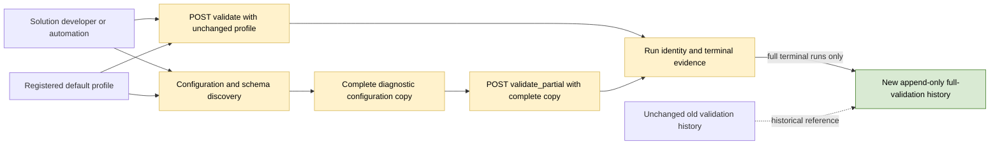

## SDD validation contract migration

### 1. Requirement analysis

`agent-validation` PR #14 and its spec 12 replaced fixed partial populations with registered full-validation configurations and complete caller-supplied partial configurations. They also added configuration/schema discovery, run-aware results and errors, and terminal run evidence. This increment aligns `reliable-agent`'s documentation and validation history with that contract. It does not change agent behavior, models, sampling, metrics, acceptance thresholds, or registered validation profiles.

- **R1. Constitution validation procedure.** Revise Section 3 of `.internal/constitution-spec.md` to describe the current HTTP contract. `POST /validate` accepts only `repo`, `commit`, and optional `solution_overrides`, and uses the unchanged active registered profile. `POST /validate_partial` additionally requires `configuration`, containing a complete modified copy of a registered base configuration, and accepts an optional base `profile`. Document `GET /profiles/{profile}/configuration`, including its normalized `configuration` and machine-readable `schema`, and the fetch–modify–submit workflow. Partial validation is diagnostic configuration modification, not necessarily a reduced or faster run, and cannot certify acceptance even when its population equals full validation or all reported criteria are accepted.
- **R2. Run-aware public contract.** Document `run_id` and `artifacts_location` in successful results and in errors raised after run creation. Add both fields to the constitution's response example. Explain that `profile` identifies the registered base profile, that completed runs store the same complete result at `<artifacts_location>/result.json`, and that terminal run status is distinct from the implementation outcome. Identify `default` as authoritative for project acceptance and `blocksworld_hard` as supplementary.
- **R3. README migration.** Update `README.md` with the same full, discovery, and partial HTTP workflows, run identity, evidence locations, diagnostic-only partial semantics, and acceptance roles. Keep the documented examples syntactically valid without embedding a complete registered configuration in the README.
- **R4. Split validation history.** Move the existing `.internal/validation-results.md` unchanged to `.internal/validation-results-old.md`; its entries and referenced historical JSON responses remain evidence under the earlier contracts and must not be reformatted or rewritten. Create a new `.internal/validation-results.md` from the current SDD full-validation-history template, with a concise link to the old file. Use the new file only for full-validation runs performed after this migration. Every completed, failed, or aborted full run must be appended with its run ID, related spec when applicable, solution commit, run status, and the path or URI returned as `artifacts_location`; never replace an earlier row. Partial runs must not be added to either history file.
- **R5. Historical-spec notes.** Add narrow supersession notes to specs 01, 03, and 04 where their validation acceptance checks assume the pre-migration HTTP request, response, or history contract. Point to this spec and the current constitution procedure without changing historical implementation requirements, validation evidence, or performance conclusions.
- **R6. Compliance-only scope.** Do not modify `src/reliable_agent/`, provider configuration, agent decision logic, solution protocol behavior, VM1–VM10, AC1–AC7, or any `agent-validation` file. No new project terminology is required; use the established validation-service terms.
- **R7. Validation of the migrated revision.** Exercise the current discovery and partial interfaces against a pushed implementation commit. Before the implementation PR is ready for integration, perform full validation with the unchanged authoritative `default` profile against the final pushed revision, append its terminal record to the new history, and ensure that the latest full-validation result is at least `valid` as required by the SDD implementation workflow. This increment does not require all project acceptance criteria to become `accepted`.

Expected behavior variants:

- **B1. Full run completion.** A completed full run returns run identity and criterion outcomes, stores `result.json`, and receives a `completed` history row. Its implementation outcome may be `accepted`, `valid`, or `invalid` according to the SDD definitions.
- **B2. Full run failure or interruption.** Failed and aborted full runs receive corresponding history rows with the same identity fields. They need not have `result.json`; post-creation errors expose the run identity needed to locate their evidence.
- **B3. Partial configuration.** A submitted copy may be unchanged, smaller, or as large as the registered full population. Every such run remains `partial`, returns run identity, and is excluded from the full-validation history.

### 2. Tests

- **T1. Documentation contract review.** Check the constitution and README against R1–R3. Verify that full requests reject inline configuration, partial requests require a complete `configuration`, discovery is documented, result examples contain `run_id` and `artifacts_location`, and no text defines partial validation as necessarily reduced or certifying. Verify the acceptance roles and full-history instructions. Covers R1, R2, R3, B1, B2, and B3.
- **T2. History migration check.** Verify that `.internal/validation-results-old.md` is byte-for-byte identical to `.internal/validation-results.md` on `main`, that all historical JSON response files remain unchanged, and that the new history contains the SDD table, no copied historical rows, and a link to the old file. Covers R4.
- **T3. Historical-spec review.** Verify that every stale validation-interface acceptance check in specs 01, 03, and 04 has a targeted supersession note and that unrelated requirements and recorded evidence are unchanged. Covers R5.
- **T4. Real partial-interface check.** Fetch the `default` configuration and schema from the merged validation service, submit a complete modified copy with a minimal diagnostic population to `/validate_partial` for the pushed commit, and verify HTTP 200, base profile `default`, scope `partial`, nonempty run identity, and equality with the stored `result.json`. Do not add this run to either full-validation history. Covers R1–R4, R7, and B3.
- **T5. Regression checks.** Run the complete provider-independent `reliable-agent` test suite and Ruff. Confirm that the diff contains no production-source or validation-service changes. Covers R6.
- **T6. Full-validation workflow.** Run unchanged `default` full validation for the final pushed revision. Verify that the returned run ID and `artifacts_location` match the manifest and, for a completed run, `result.json`; append exactly one new history row with the correct terminal status. Repeat after any later implementation-affecting review change. The latest full result must be at least `valid` before review completion. Covers R4, R7, B1, and B2.

### 3. High-level solution design

The layered runtime architecture in the constitution is unchanged: integration interfaces, agent decision logic, and model and tool access keep their current components and boundaries. Only the documented interaction with the external validation service and the management repository's validation-history files change.

The migration separates historical evidence from new run records instead of translating old responses into a format they did not originally use. New full runs use the current run-aware contract from the outset, while partial runs remain diagnostic and leave both history files untouched.
