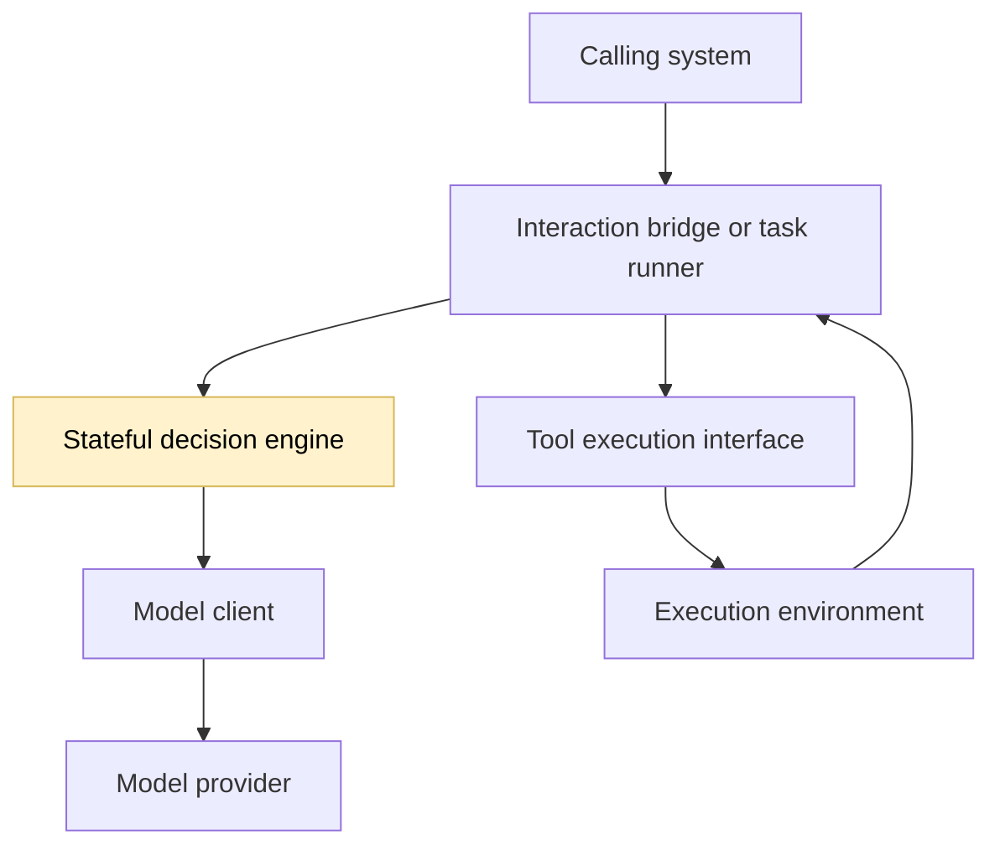
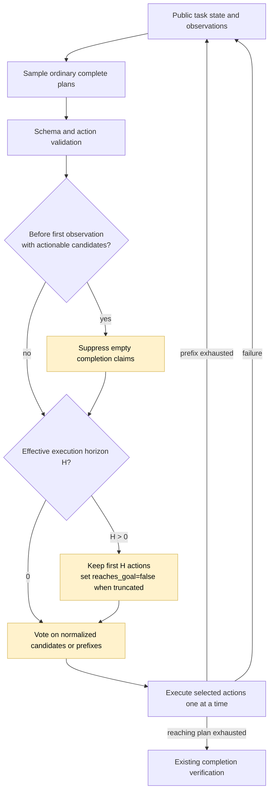

## Observed-state prefix consensus

### 1. Executive summary

#### 1.1 Spec description

Add an execution horizon that is independent of the model's requested planning horizon. The agent can sample ordinary complete plans, truncate candidates to a common action prefix before voting, execute only the selected prefix, and plan again from the resulting public observation. Before the first observation, valid actionable plans suppress empty completion claims when both are present, preventing identical empty candidates from forming an artificial majority. This implements the candidate developed in the [AC3 repeatability investigation](../investigations/ac3-repeatability.md).

#### 1.2 Spec motivation

The latest unchanged-agent full `default` runs produced project VM4 values of 0.15 and 0.25 against the 0.05 limit. Whole-plan votes often resolve through sample-index ties, while short action prefixes have a stronger mode. Prompt-controlled short horizons were already rejected because the model did not follow them reliably and could produce only empty plans. Engine-enforced prefixes with ordinary complete-plan prompts instead achieved diagnostic project AC3 acceptance over three full-task-set repeats in run `20261118T034306-781510Z-53b3a0db4c66`, with VM4 = 0.04999999999999993.

#### 1.3 Implementation repos

https://github.com/anton-pershin/reliable-agent — management and implementation repository.

### 2. Requirement analysis

#### 2.1 Functional requirements

- **FR1. Unchanged model and sampling.** Validation must use `openai:qwen/qwen3.5-9b` with temperature 0.7 and the established serving defaults. The change must not introduce fixed-repeat seed overrides, deterministic-serving modes, or other sampling restrictions prohibited by constitution preference P11.
- **FR2. Independent execution horizon.** `AgentConfig.plan_execution_horizon` and `--plan-execution-horizon` must accept integers from 0 through 50, with default 0. A value H > 0 must bound voted and executed plan prefixes without changing the plan instructions. The existing `plan_horizon` remains a prompt-controlled horizon and a fallback execution limit for backward compatibility; an explicit execution horizon takes precedence.
- **FR3. Pre-vote truncation.** For every valid candidate with more than H actions, the engine must retain exactly the first H actions and set `reaches_goal=false` before failed-plan filtering, review, goal selection, and voting. Candidates at or below H retain their completion flag. Consequently, vote counts represent normalized prefixes rather than discarded plan tails. If candidates with the same normalized prefix disagree about completion, the selected prefix must be non-reaching; completion verification requires unanimous completion claims within that vote group and must not depend on race completion order.
- **FR4. Observed-state progression.** A truncated prefix must execute through the existing single-action runner flow. Successful exhaustion must trigger re-planning without completion verification; action failure and transient retry behavior remain unchanged. Each new vote must receive the public history produced by earlier prefixes.
- **FR5. Empty-claim control before evidence.** While an episode has no action observations and at least one valid nonempty candidate exists, empty `reaches_goal=true` candidates must be excluded from the vote. Empty-only rounds must retain immediate completion verification so an initially satisfied objective can complete. After an observation, empty claims retain the existing voting and verification behavior. Empty `reaches_goal=false` candidates remain invalid.
- **FR6. Observability.** Log the effective execution horizon, number of truncated candidates, selected completion flag, and number of empty claims suppressed with episode and plan-round identifiers. Existing plan candidate, vote, selection, exhaustion, failure, verification, and termination evidence must remain available.
- **FR7. General-purpose boundaries.** The mechanism must operate only on public action requests and observations. It must not parse benchmark identities, inspect private goals or results, add a benchmark-specific solver, or move benchmark integration into the decision engine.
- **FR8. Configuration compatibility.** Defaults must preserve the previous complete-plan voting and execution behavior apart from the explicit empty-claim rule. Existing overrides and public protocol shapes must continue to work.

#### 2.2 Non-functional requirements

- **NFR1. Repeatability.** Under a 10-repeat, 20-task unperturbed partial run, project VM4 must be at most 0.05. Final confirmation under unchanged full `default` validation must also satisfy project AC3.
- **NFR2. Success floor.** VM1 must remain at or above 0.50 on the 10-repeat diagnostic. Improving the three-repeat value of 0.5667 and reducing avoidable timeouts is preferred; the execution horizon may be tuned without changing the model or sampling settings.
- **NFR3. Budget compliance.** Project AC6 and AC7 must be accepted in diagnostic and final validation, with no more than 50 action attempts and at least 95% timely final responses.
- **NFR4. Testability and regression.** Model doubles and controlled clocks must cover the new behavior without a provider. The complete provider-independent suite and lint checks for changed files must pass.
- **NFR5. No criterion regression.** Final full validation must not make a previously computable criterion invalid. AC2, AC4, and AC5 need not be included in screening populations, but their final full results must be reported rather than inferred from partial runs.

### 3. Acceptance criteria

- **AC1. Configuration contract.** Tests must show the default execution horizon is 0, valid overrides parse, invalid values are rejected, explicit execution H takes precedence over prompt horizon, and execution H alone leaves complete-plan instructions unchanged. Covers FR2 and FR8.
- **AC2. Prefix vote.** Tests with distinct plan tails must show that pre-vote truncation turns a raw tie into a prefix majority, selects the correct sample, executes only that prefix, and records the effective horizon and truncation count. A mixed-completion vote group must produce a non-reaching winner independent of sample completion order. Covers FR3 and FR6.
- **AC3. Round flow.** Tests must show that truncated candidates become `reaches_goal=false`, exhaust into re-planning without verification or failure feedback, preserve transient retries, and allow a later reaching plan to verify and complete. Covers FR3 and FR4.
- **AC4. Empty claims.** Tests must show that actionable candidates suppress empty completion claims before the first observation, an empty-only initial round still verifies, and an empty claim after an observation retains its prior behavior. Covers FR5.
- **AC5. Regression and isolation.** The provider-independent test suite must pass, including concurrent episode isolation and action/time budget tests. Changed files must pass Ruff and the diff must contain no validation-service dependency or benchmark-specific decision logic. Covers FR1, FR7, NFR3, and NFR4.
- **AC6. Ten-repeat partial validation.** Submit a complete modified `default` configuration containing all 20 tasks, 10 unperturbed repeats, no prompt variants or failure scenarios, and only project AC1/AC3/AC6/AC7. The result must have every requested metric computed, project AC3 accepted, VM1 >= 0.50, and AC6/AC7 accepted. Retain the run ID and directory in the investigation; do not add it to full-validation history.
- **AC7. Full validation.** Run unchanged authoritative `default` validation on the final pushed revision and append its terminal record to `.internal/validation-results.md`. Project AC3 must be accepted, the latest full result must be at least valid, and all criterion outcomes must be reported. Covers NFR1, NFR2, NFR3, and NFR5.

### 4. High-level solution design

The constitution's layered architecture is unchanged. Only the stateful decision engine and its configuration are modified; the interaction bridge, runner, model/tool access boundary, and external environment retain their responsibilities.

Within the existing planning round, prefix enforcement occurs before candidate selection:

**Why prompt and execution horizons are separate.** The aborted prompt-controlled H=1 run `20261118T033123-886755Z-6e1f0c6f57aa` produced all-empty votes on initial easy tasks and did not exercise prefix execution. Ordinary complete-plan prompts preserve actionable candidate diversity; the engine, rather than model instruction compliance, enforces the common prefix.

**Why empty claims need special handling before evidence.** Empty claims normalize to one identical vote key and can outvote diverse actionable plans without supplying environment evidence. Suppression applies only when valid action candidates exist and no observation has occurred, so empty-only initially satisfied tasks and post-observation completion checks still work.

**Why H is configurable.** H=1 produced the first diagnostic AC3 acceptance but increased planning-round latency. H=2 or another value may offer a better consensus/time tradeoff. Keeping H outside the prompt allows this tradeoff to be measured without confounding it with a changed generation distribution.
